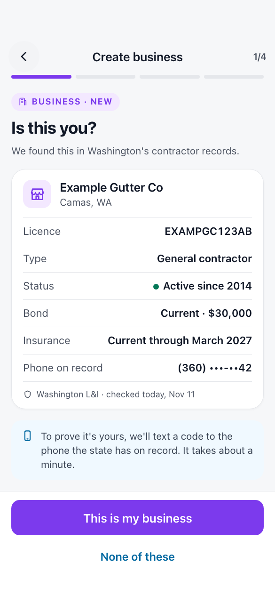

# The screens

November 11, 2026 · Status: the sample board is drawn and waits for the
founder's OK. The other fourteen are listed, not drawn.

The boards are on the private Design canvas
[The business graph](https://claude.ai/artifact/A3Vr8tG3uswcd8C678nKUe).

## How they are made

On a private Design canvas, built from the shipped app's own screens and the
Pantopus design system, the way the Plans boards were: the app's screens with
the new parts added, in light and dark. iPhone size for app boards; a wide
board where the screen is for the web. Sample data is made up; no real business
or person appears.

## The sample

**K2, "Is this you?"** on iPhone, light. It is the screen the whole business
file turns on: the owner has typed a name, and Pantopus shows the state's
record with its licence, city and status, a masked phone, and "This is my
business". It shows how a record's lines look and the source-and-date line
every fact carries. A record that is already claimed is on K5.

## The boards

| | Board | Shows | For |
| --- | --- | --- | --- |
| K1 | Find your business | The create wizard's first step with a search box; results from the state record, the catalog and the map as one list | Business file 2, 3 |
| K2 | Is this you? | One record in full, with source and date; "This is my business"; "None of these" | 2 |
| K3 | Prove it | The code sent to the masked phone; six boxes; "Call me instead"; "Try another way" | 2 |
| K4 | Proved | The page filled in from the record; "Verified with Washington L&I" | 2 |
| K5 | When it can't | Each refusal in place: already claimed, no phone on record, too many codes, wrong code with tries left | 2 |
| K6 | Other ways to prove | Email at your domain; a mailed code; a document | 3 |
| P1 | The public page | Licence, bond and insurance lines with the state's date; a line that expires soon; a suspended line | 2 |
| P2 | A review with proof | "Paid customer" on a review | 6 |
| F1 | The file | "Here is what the public record says about you": each line with source, date, Confirm, Fix, Hide | 4 |
| F2 | An alert | "Your bond ends in 23 days", in the notices list and as a push | 4 |
| M1 | The statement | A month across every feature: sales, who Pantopus brought, what it kept and why, payouts (wide, for the web) | Piece 4 |
| M2 | The statement on a phone | The same month, folded | Piece 4 |
| M3 | People you know | The customer list: first name, how they came, what they bought | Piece 3 |
| U1 | Businesses that know me | A person's list under Settings, with "Hide me from this business" | Piece 3 |
| L1 | A place | A business's location with its plans, the posts and Moments tagged there | Piece 2 |

Fifteen boards, each in light and dark.

## Rules the boards keep

- Working screens keep their layout, styling and navigation. The wizard, the
  business page and Settings gain parts; none is redrawn.
- The side menu button stays on the top screen of every tab.
- No board shows a person's last name, address, phone or email to a business.
- No board shows a street address for a home-based business.
- Every fact about a business shows where it came from and when.
