# The screens

November 11, 2026 · Status: all fifteen boards are drawn, in light and dark.
The founder approved the sample (K2) on November 11 and has not yet looked at
the other fourteen. Seven boards were corrected on November 12 (see
[Corrections, November 12](#corrections-november-12)); the pictures below are
the corrected ones.

The boards are on the private Design canvas
[The business graph](https://claude.ai/artifact/A3Vr8tG3uswcd8C678nKUe), on
two pages, Light and Dark. The pictures below are the light boards.

## How they are made

On a private Design canvas, built from the shipped app's own screens and the
Pantopus design system, the way the Plans boards were: the app's screens with
the new parts added, in light and dark. iPhone size for app boards; a wide
board where the screen is for the web, or where one board shows several states
side by side. Sample data is made up; no real business or person appears.

## The boards

| | Board | Shows | For |
| --- | --- | --- | --- |
| K1 | Find your business | The create wizard's first step with a search box; results from the state record, the catalog and the map as one list | Business file 2, 3 |
| K2 | Is this you? | One record in full, with source and date; "This is my business"; "None of these" | 2 |
| K3 | Prove it | The code sent to the masked phone; six boxes; "Call me instead"; "Try another way" | 2 |
| K4 | Proved | The page filled in from the record; "Verified with Washington L&I" | 2 |
| K5 | When it can't | Each refusal in place: already claimed, no phone on record, couldn't send, wrong code with tries left, code expired, too many codes | 2 |
| K6 | Other ways to prove | Email at your domain; a mailed code; a document | 3 |
| P1 | The public page | Licence, bond and insurance lines with the state's date; a line that expires soon; a suspended line | 2 |
| P2 | A review with proof | "Paid customer" on a review | 6 |
| F1 | The file | "Here is what the public record says about you": each line with source, date, Confirm, Fix, Hide; only lines a measured source carries | 4 |
| F2 | An alert | "Your bond ends in 22 days", in the notices list and as a push | 4 |
| M1 | The statement | A month across every feature: sales, who Pantopus brought, what it kept and why, payouts (wide, for the web) | Piece 4 |
| M2 | The statement on a phone | The same month, folded | Piece 4 |
| M3 | People you know | The customer list: first name, how they came, what they bought | Piece 3 |
| U1 | Businesses that know me | A person's list under Settings, with "Hide me from this business" | Piece 3 |
| L1 | A place | A business's location with its plans, the posts and Moments tagged there | Piece 2 |

Fifteen boards, each in light and dark.

## Claim: find your business and prove it

**K1, Find your business.** The wizard's first step. One list, and each row
says where it came from: a state record, a business listing, or the map.
Picking a row claims nothing.

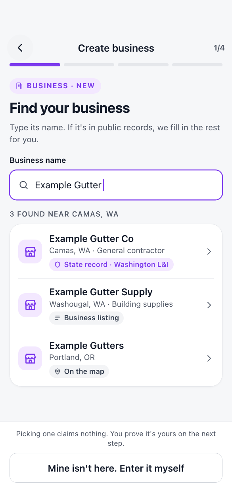

**K2, "Is this you?"** The sample, approved November 11. The owner has typed
a name, and Pantopus shows the state's record with its licence, city and
status, a masked phone, and "This is my business".

**K3, Prove it.** The code goes to the phone the state has on record. The
number stays masked.

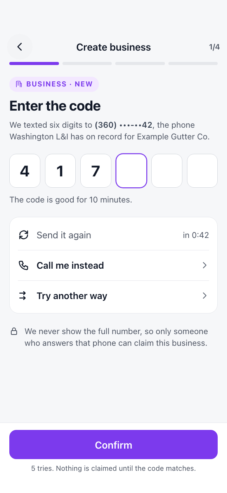

**K4, Proved.** The wizard's second step, filled in from the record. The
sample business works from home, so it shows a city and no street.

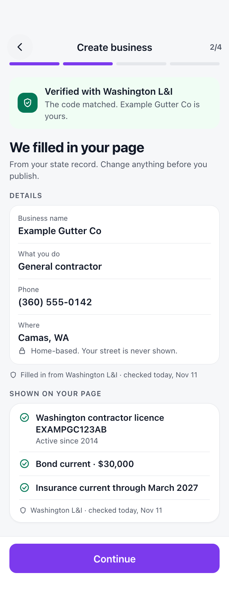

**K5, When it can't.** One board with the six refusals of the claim routes,
each in the place it happens.

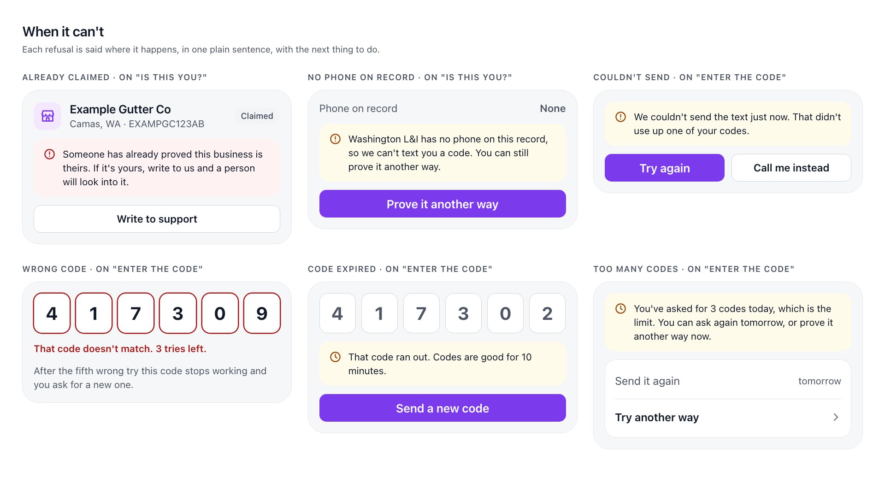

**K6, Other ways to prove.**

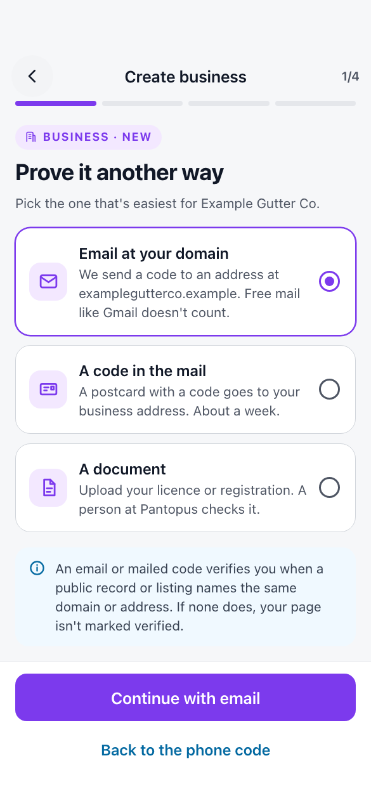

## The public page and the business file

**P1, The public page.** The page gains one card. Beside it, the same card
when a bond ends within 30 days and when the state has suspended the licence.

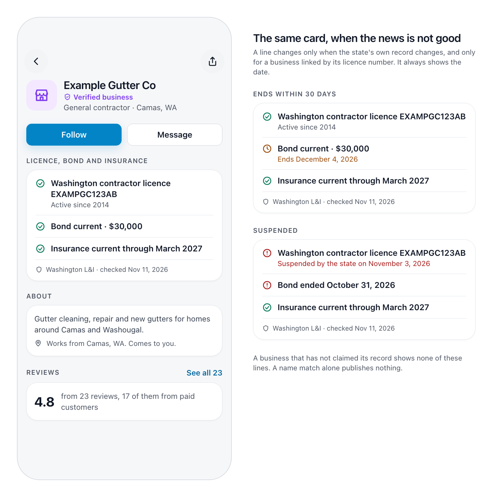

**P2, A review with "Paid customer".**

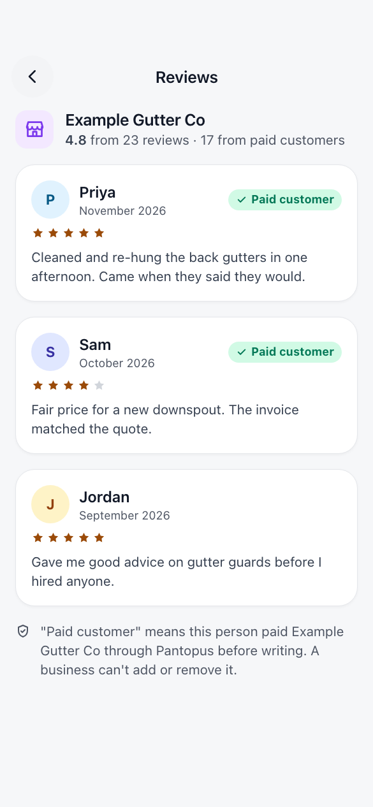

**F1, The file.** Six lines in five states: confirmed, found, fixed by the
owner, none found, hidden. Every line is one a measured source carries
([07-data-design.md](07-data-design.md)): the licence, the bond with its surety
and the insurance with its insurer from Washington L&I; the phone; the website,
the category and a second phone from a business listing. No source measured has
opening hours, so the Hours line says "None found" and asks the owner to add
them.

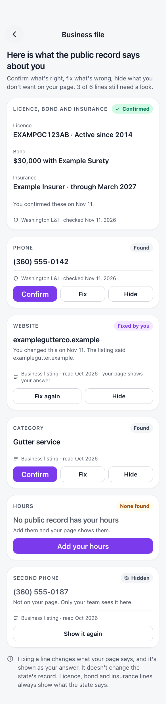

**F2, An alert.** The push, over the notices list that holds the same notice.

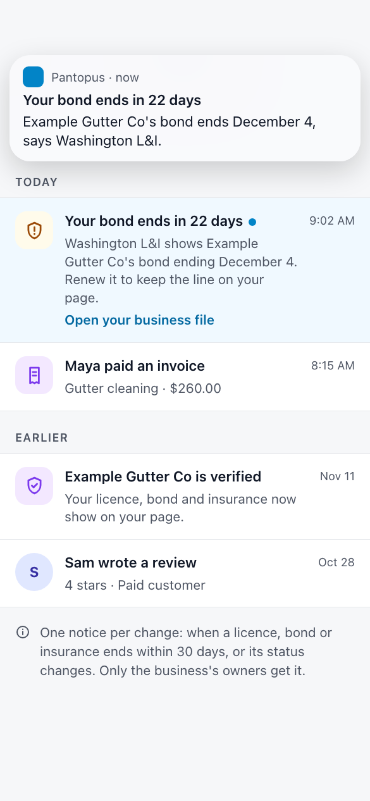

## The books, the person and the place

**M1, The statement, on the web.** The sample month adds up: $6,460.00 paid,
less $20.00 refunded, $944.00 kept by Pantopus and $9.68 in card fees, leaves
$5,486.32, of which $4,870.32 is paid out and $616.00 is on its way. The
table's paid and kept are after the refund, and the board says so under it.

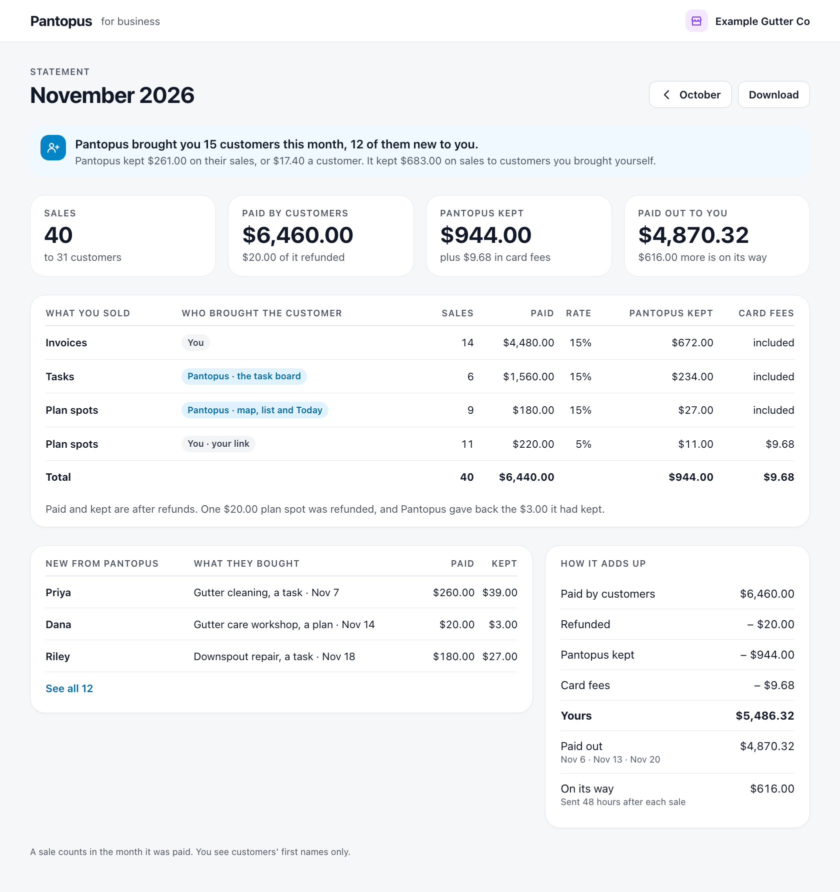

**M2, The statement on a phone.**

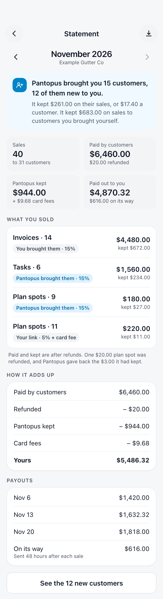

**M3, People you know.**

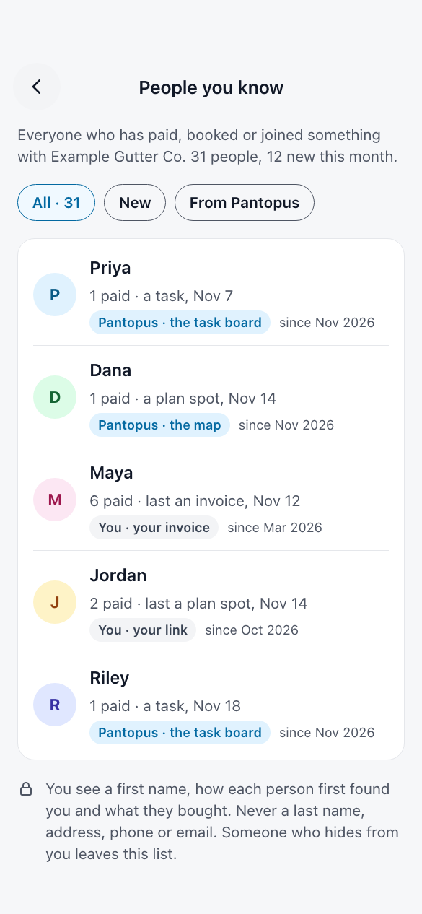

**U1, Businesses that know me.** The list under Settings, with the sheet that
opens from "Hide me".

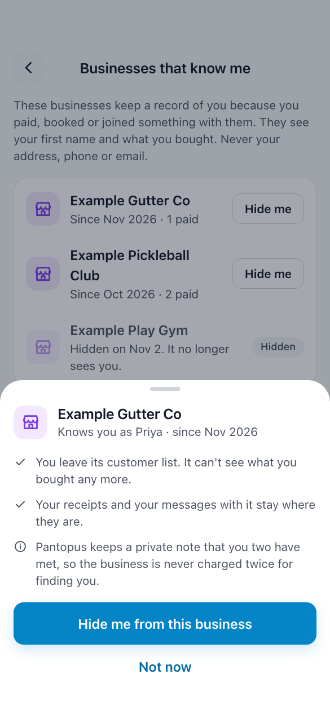

**L1, A place.** A second made-up business, one with a place people visit,
since the gutter company works from home and has no place to show.

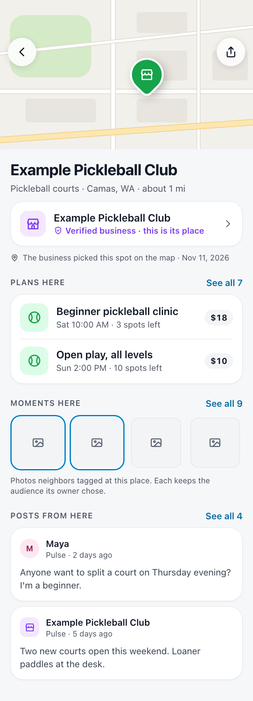

## Calls the boards make

The founder has not seen these. Each is a drawing choice, open until confirmed.

- **K5 shows six refusals, not four.** The claim contract (section 3.4) has
  six; the list above named four. "Code expired" and "Couldn't send" are added.
- **The statement says what Pantopus kept on the business's own customers.**
  Under the contract an invoice is charged the full rate even when the business
  brought the customer. So the sample month's banner reads: $261.00 kept on
  customers Pantopus brought, $683.00 on customers the business brought itself.
- **The statement's first table is by what was sold and who brought the
  customer**, one row for each pair, in place of the contract's two lists
  (`by_feature`, `by_way_in`).
- **"On its way"** is the name for money earned and not yet paid out.
- **"Fixed by you"** is the name for a file line the owner corrected. A hidden
  line can be shown again.
- **Licence, bond and insurance lines can be confirmed but not fixed or
  hidden** in the file. The board says so in its last line.
- **A business sees "since November 2026"** for when it first met a person, to
  the month, as the contract's `first_met` is.
- **The hide sheet tells the person** that Pantopus keeps a private note that
  the two have met, so a fee is never charged twice (call S5). A hidden
  business stays in the person's list, marked "Hidden", with no way back drawn.
- **A mailed code "takes about a week".** The contract gives no time.
- **L1 shows Moments as blank tiles**, not photos, and says each keeps the
  audience its owner chose.
- **No board has the side menu button**, because none is the top screen of a
  tab. Each opens from another screen and has a back button.
- **P1 and K5 are wide boards**, so one picture can hold a screen and its
  other states.
- **The file names the surety and the insurer** beside the bond and the
  insurance, and shows an empty Hours line as "None found" with "Add your
  hours" (added November 12).

## Corrections, November 12

Reading the boards side by side turned up places where they disagreed with
each other or with the measured data. Fixed on these boards, light and dark:

- **F1 showed lines no source has.** Its Hours ("Monday to Friday, 8 AM to
  5 PM") and Year started (2009) were labelled "Business listing", but the
  data design found no source with opening hours and none with a year started
  for a Washington business. Hours is now "None found" with "Add your hours";
  Year started is gone. The file gained the surety and the insurer from the
  state's bond and insurance files, the listing's category, and a hidden
  second phone as the hidden example.
- **The same customers now agree on F2, M1, M3, P2 and U1.** Priya paid once,
  for a task on November 7 (M3 and U1 had said three times, last by invoice).
  Maya, the business's own invoice customer, paid the invoice in F2. Sam wrote
  the October review that mentions an invoice (it was Dana's, but Dana first
  paid on November 14, after it). Jordan was first met in October, after his
  September review, so it rightly has no "Paid customer". F2's "today" is
  November 12, the day after the business was verified, so the bond ends in 22
  days.
- **M2's banner** now says what Pantopus kept on the business's own customers
  ($683.00), as M1's does.
- **M1 and M2** say that paid and kept are after the $20.00 refund; the table
  totals $6,440.00 against $6,460.00 paid.
- **K6's chosen option** is business violet, as the rest of the wizard is, not
  the person blue. Its note now says plainly that without a matching record the
  page isn't marked verified, in place of "counts toward your standing".

## Rules the boards keep

- Working screens keep their layout, styling and navigation. The wizard, the
  business page and Settings gain parts; none is redrawn.
- The side menu button stays on the top screen of every tab.
- No board shows a person's last name, address, phone or email to a business.
- No board shows a street address for a home-based business.
- Every fact about a business shows where it came from and when.
