# Plans with businesses: the design

November 11, 2026 · Status: a design. Nothing is built. It follows the
[proposal](01-proposal.md) and is what the [build contract](03-build-contract.md)
builds against.

The boards are on a private Design canvas,
[Plans with businesses](https://claude.ai/artifact/W7CYVbCejsR9oP5BUdLTMv): 22
boards on a Light page and a Dark page. The pictures in [screens/](screens/) are
the light boards. Every business, person, price and count on them is made up.

The boards were built from the shipped Plans boards (the October 13 "Nearby Plans
Screens" canvas), so layouts, type, colors, pins and rows are the app's own. Only
the parts listed under [What is added](#what-is-added) are new.

## What it is, in one paragraph

A verified business can host a plan in Plans, at its own place, free or with a
price on each spot. Guests find it where they find every plan, pay in the app when
they join, and get a full refund if they leave in time. The business sees who is
coming and how each guest found it, and pays Pantopus a fee only on guests who
paid. A neighbor's plan works exactly as it does today.

## Principles

1. **A neighbor's plan doesn't change.** The same button, kinds, composer, ask and
   accept, private place and group chat. Free, with no card, ever.
2. **A business's plan is a plan.** The same pin, row, page, reminder, chat and
   "On my way". Five small parts are added; nothing is replaced.
3. **Neighbors stay in front.** One order for everyone: soonest first, then
   nearest. A business takes one row and one pin however much it posts.
4. **The price is never a surprise.** It is on the row, the page, the notice and
   the button. The refund rule sits beside it.
5. **The fee is shown, not claimed.** Each guest's way in is recorded and shown to
   the business on the roster and the statement.
6. **A business sees less than a neighbor host.** A first name, how many are
   coming, a note, and how they found the business. Never an address, a phone
   number, an email or how far away they live.
7. **Nothing is for sale but the spot.** No paid placement, no data, no "deals".

## What is added

Board [P1](screens/p1-marks.png) holds the parts.

| Part | What it is | Where |
| --- | --- | --- |
| The business shape | A rounded square with the store glyph in the business color (#7C3AED on #F3E8FF; dark #A78BFA on #221833). A person stays a circle | The "Hosted by" card, the business page, "Host as" |
| The business badge | A small solid violet square with a white ring | On the kind tile of a row and on a pin |
| "Verified business" | The shield used for "Verified address", in the business color | The "Hosted by" card, the share page, the business page |
| The price chip | "$18" in bold; "Free" in plain weight | Rows, cards, the share page |
| The label | What the business calls it: "Clinic", "Open play", "Kids' class". The plan keeps its kind's color, glyph and pin | The chip on the page and the share page |
| The filter | All · Neighbors · Businesses | Under the list's title |
| The fold | "3 more times this week at this club" | Under a venue's row |
| The way-in chip | "Found on the map · new", "Your link" | The roster and the statement, for the business only |

**Kids' classes.** The playdate color and the business color are the same violet.
They stay apart by shape: the kind is a soft tile, the business badge is a solid
square with a white ring.

## The guest's screens

### G1 · The map: neighbors and businesses

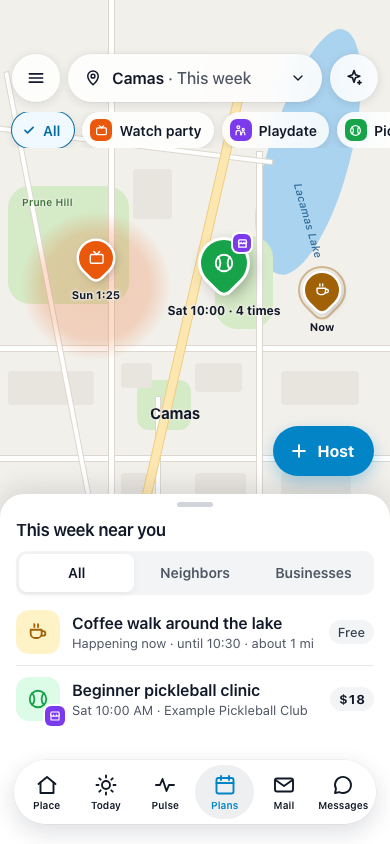

- A neighbor's pin keeps its shaded area: the place is private. A business's pin
  has the badge and no shaded area: the place is exact.
- One pin for a venue. Its tag gives the soonest time and how many more there are
  ("Sat 10:00 · 4 times").
- The sheet's list gets the filter. Rows show a price chip where a plan has a
  price, and "Free" beside it where one doesn't, so the two read the same way.
- Unchanged: the area pill, the kind chips, Ask, the side menu, "Host", the tab
  bar (drawn as Place · Today · Pulse · Plans · Mail · Messages).

### G2 · The list, with the filter

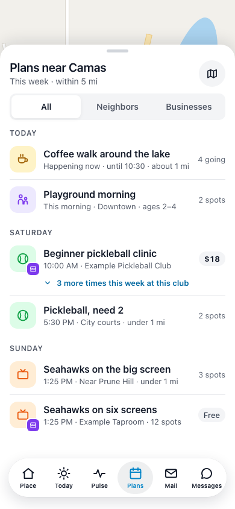

- The order is today's: by day, then time, then distance. Neighbors' and
  businesses' plans are mixed in it.
- A business's row: the badge on the kind tile, the business's name where a
  neighbor's row names an area, and the price where a neighbor's row shows spots.
- A venue's later plans fold under its soonest one. Opened, they list as short
  lines ([P3](screens/p3-filter.png)).
- The filter shows only once a business has a plan in the area, so Plans looks
  exactly as it does today until then. The app remembers the choice.

### G3 · A business's plan, before you join

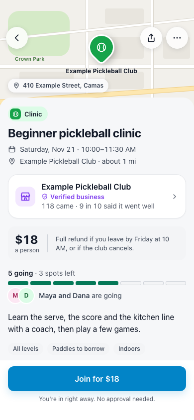

Top to bottom, against a neighbor's page (G7):

| A neighbor's plan | A business's plan |
| --- | --- |
| Shaded area, "Exact place shared when you're in" | A pin at the place, with its name and street address |
| "Watch party" | The business's label, in the kind's color |
| Host card: a person, "Verified address", plans hosted, mutual connections | "Hosted by" card: the business, "Verified business", "118 came · 9 in 10 said it went well" |
| (none) | The price beside the refund rule |
| "5 going · 3 spots left", "Names show once you're in" | The same count, plus people you know who are going |
| "Sam approves each person" | Facts as chips: "All levels", "Paddles to borrow", "Indoors" |
| "Ask to join" | "Join for $18", "You're in right away. No approval needed." |

The proof line shows only once at least 20 guests have answered "How did it go?"
for this business. Before that the card says how many plans it has hosted.

### G4 · Join and pay

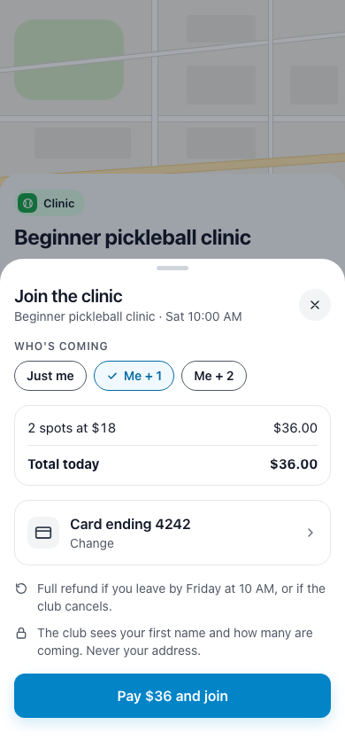

- The same sheet as "Ask to join": who's coming, then the total, the card, and
  the two promises (the refund rule, and what the business sees).
- One button: "Pay $36 and join". The card is a saved card or a new one through
  the payment sheet the apps already use for business invoices.
- No "Say hi" box on a plan that lets people in right away.

### G5 · You're in

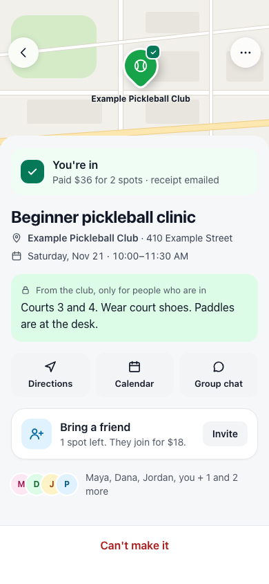

- Today's "You're in" page with one new line in the banner ("Paid $36 for 2 spots
  · receipt emailed") and one new card ("Bring a friend").
- The pin carries the green check, as it does today.
- The note "From the club, only for people who are in" is today's private note.

### G6 · Leave and get a refund

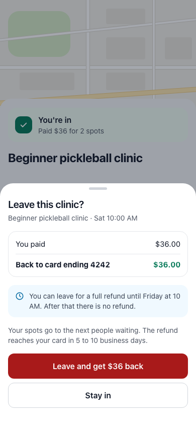

- "Can't make it" opens this sheet on a paid plan. It says what comes back and
  where, and when the free window closes.
- After the window the sheet says there is no refund and the button reads
  "Leave without a refund".
- On a free plan "Can't make it" works as it does today, with no sheet.

### G7 · A neighbor's plan, unchanged

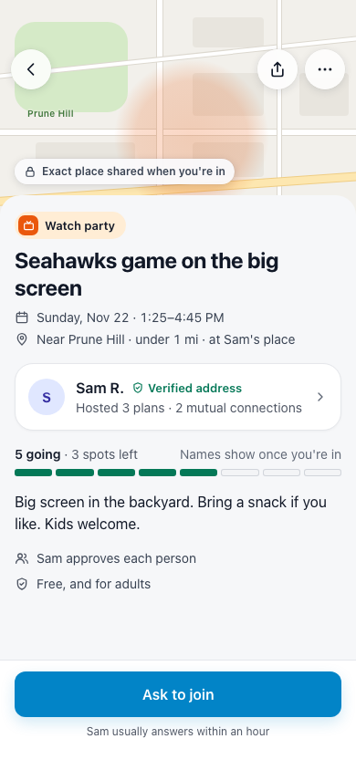

Drawn to be compared with G3. It is today's page: the area, "Ask to join", free.

## The doors: how a guest arrives

Each guest's way in is saved when they join. The contract lists the ways and
which rate each carries.

### D1 · Notices that bring a guest

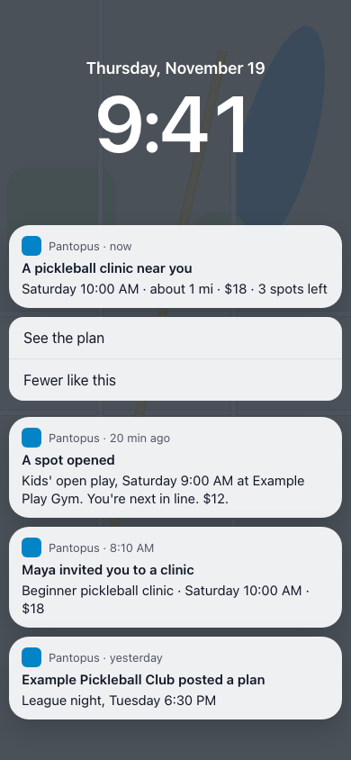

Four notices, top to bottom: a kind the person asked to hear about ("Plans you'd
like", which exists today), a spot that opened for someone waiting, an invitation
from someone they know, and a new plan from a business they follow. Every notice
about a paid plan carries the price. Board [P2](screens/p2-words.png) has every
notice's words.

### D2 · Today: a plan nearby

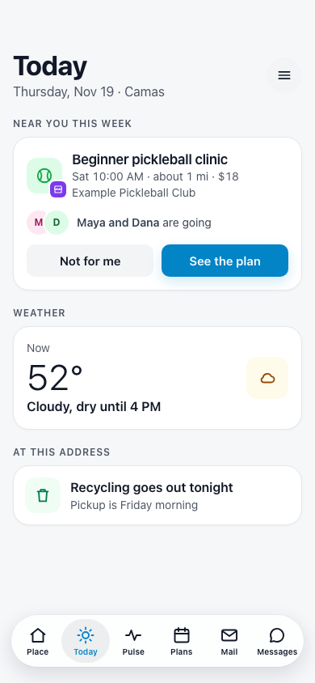

- One card, "Near you this week", for a plan that fits the person: a kind they've
  joined or asked about, within 2 miles, with a spot left.
- At most one such card a day, and none if the person turned Suggestions off or
  said "Not for me" to this kind twice.
- "Maya and Dana are going" shows only for people the viewer is connected to who
  allow it (see [Privacy](#privacy)).

### D3 · Bring a friend

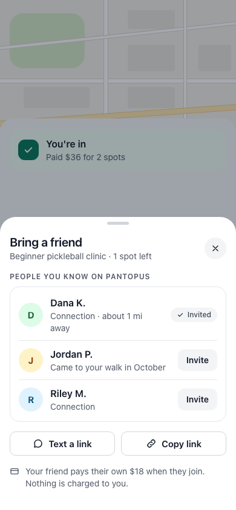

- A guest who is in can invite people they know, or send a link. Today only the
  host can invite.
- The friend pays for their own spot. Nothing is charged to the person inviting.
- Only on a business's plan. On a neighbor's plan only the host invites, as
  today.

### D4 · New here: three things to try

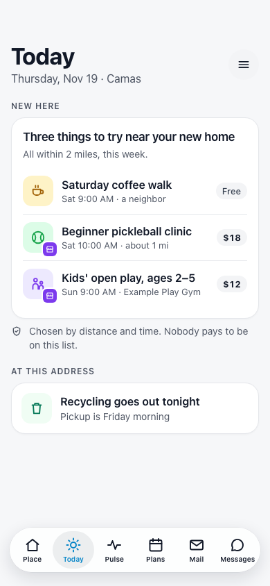

- For a household in its first 30 days on Pantopus: three plans this week within
  2 miles, neighbors' and businesses' together, by distance and time.
- The line under it is a promise the build must keep: "Chosen by distance and
  time. Nobody pays to be on this list."

### D5 · After the plan: come back

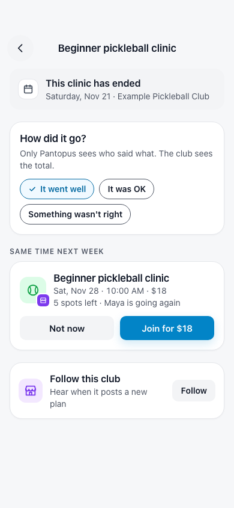

- "How did it go?" is today's question, with its three answers. The business sees
  totals, never who said what.
- A guest who said it went well is offered the next one, and can follow the
  business.

### D6 · Shared link, on the web

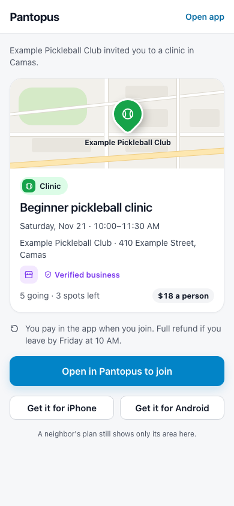

- Today's share page, with the place, the business and the price shown for a
  business's plan. A neighbor's plan still shows only its area there.
- Joining happens in the app. The web page does not take a payment.

## The business's screens

### B1 · Host as you or your business

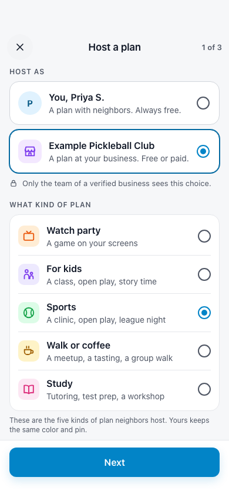

- "Host as" shows only to people on the team of a verified business who may post
  for it. Everyone else sees today's first step.
- Choosing the business keeps the five kinds and words them for a business:
  Watch party, For kids, Sports, Walk or coffee, Study.

### B2 · Time, place, spots and price

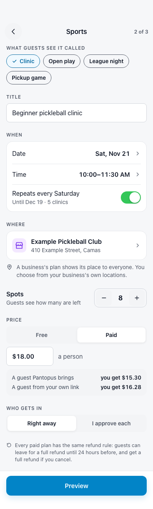

- **Label:** a short list per kind (for Sports: Clinic, Open play, League night,
  Pickup game). No free text, so a label can't become an ad.
- **Repeats:** weekly, until a date.
- **Where:** one of the business's own locations. A business never hosts at a
  home, and never at a place that isn't its own.
- **Price:** Free or Paid. As the price is typed, the business sees what it
  keeps from a guest Pantopus brings and from its own.
- **Who gets in:** right away, or the business approves each person.
- **Refunds:** one rule for every paid plan, shown here and not editable.

### B3 · Posted: bring your regulars

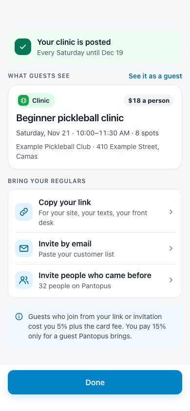

- The first thing after posting is how to bring the business's own customers: its
  link, invitations by email, and people who came before.
- The note states the two rates in one sentence.

### B4 · Who's coming, and check-in

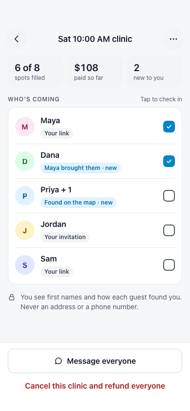

- First names, party size, the way-in chip, and "new" for a first visit.
- A tap checks a guest in. Check-in is what "came" means on the proof line and the
  statement.
- "Cancel this clinic and refund everyone" says what it does.

### B5 · The monthly statement, on the web

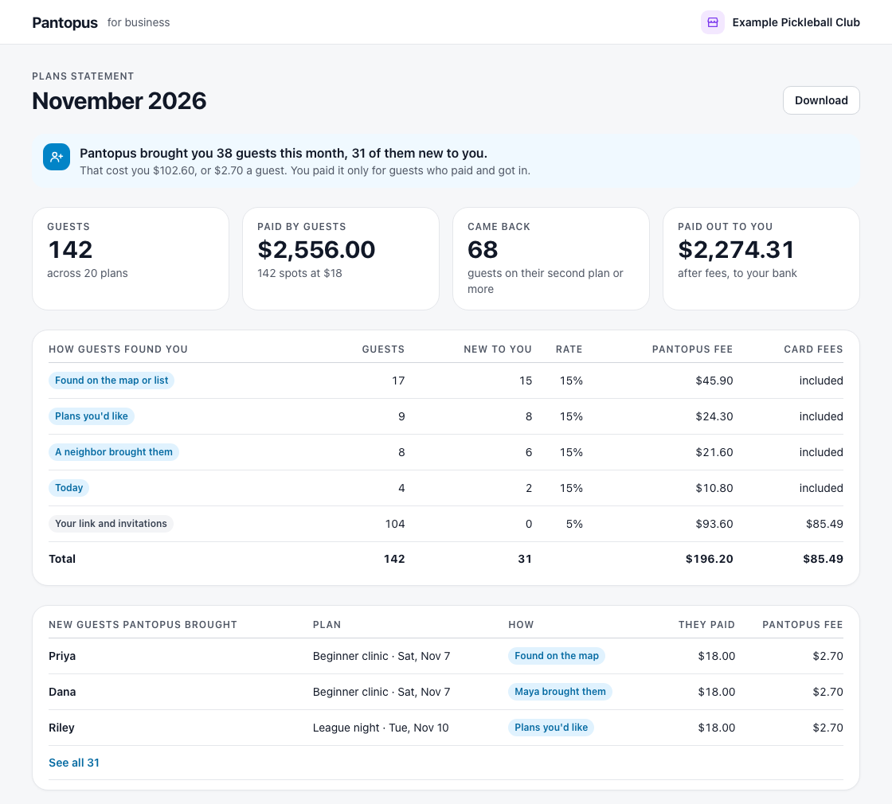

- The first line is the claim the fee rests on: how many guests Pantopus brought,
  how many were new, what it cost in total and for each.
- The table shows every way in with its rate and fee. The second table lists each
  new guest Pantopus brought, by first name.
- The numbers on the board add up: 142 guests paid $2,556.00; the fees are
  $196.20 and $85.49; $2,274.31 was paid out.

### B6 · Upcoming plans on the business page

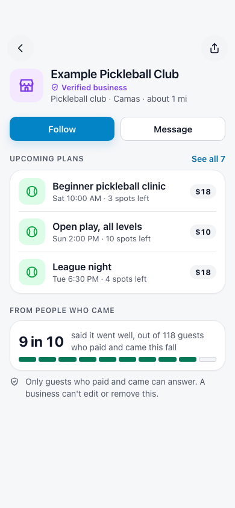

- Two new sections on the page a business already has: its upcoming plans, and
  what people who came said.
- "Follow" exists today. Following now also brings a notice when the business
  posts a plan.

## Words

Board [P2](screens/p2-words.png) has every new notice. The rules:

- A price is always in the line, never behind a tap.
- Money coming back says where it goes.
- Nothing says "deal", "offer" or "sale".
- A notice about a business's plan names the business or the kind.
- Sentence case, verbs first on buttons, no symbols for confirmations, as in the
  Pantopus design system.

## States the build must draw

The boards show the loaded state. Each new screen also needs:

| Screen | Loading | Empty | Error |
| --- | --- | --- | --- |
| G2 with the filter on Businesses | The list's skeleton | "No businesses have plans here this week." with "Show all plans" | Today's list error |
| G4 | The total as a skeleton line while the price is confirmed | (none) | "Your card wasn't charged." with the reason and "Try again" |
| G4, spot taken while paying | (none) | (none) | "That spot was just taken. Your card wasn't charged." with "Join the waitlist" |
| G6 | (none) | (none) | "We couldn't start your refund. You're still in." with "Try again" |
| B4 | Row skeletons | "No one has joined yet." with "Copy your link" | "Couldn't load who's coming" with "Try again" |
| B5 | Number and table skeletons | "No plans this month." | "Couldn't load this statement" with "Try again" |
| B6, upcoming plans | Row skeletons | The section is hidden | The section is hidden |

Offline, a paid join is refused before the sheet opens: "You're offline. Joining
needs a connection."

## Privacy

- **What a business sees about a guest:** first name as they show it to
  neighbors, party size, their note, how they found the business, whether it is
  their first visit, and whether they were checked in. For a kids' plan, the
  count and age bands of the children, as a playdate host sees today.
- **What a business never sees:** address, distance, phone, email, last name,
  other plans the person joined, or their answer to "How did it go?".
- **"People you know are going":** shown only to a person's connections, only
  first names, and only for a business's plan. A new setting, "Let people I know
  see business plans I'm going to", on by default, in Plans settings. A
  neighbor's plan keeps "Names show once you're in".
- **The proof line** counts only guests who were checked in, and shows only once
  20 have answered.
- **No data leaves.** A business gets no export of people. The statement lists
  first names only.

## Accessibility

- The price and the refund rule are text, read in order after the place.
- The business badge has a label: "a business".
- The way-in chip is text, never color alone; "new" is a word.
- Check-in is a checkbox with the guest's name in its label.
- Light and dark both drawn; text on tints follows the design system's label and
  fill tokens.

## What the boards do not decide

- The business's desk on the web beyond the statement (posting and the roster on
  a wide screen). The phone boards B1 to B4 are the reference.
- Android's drawing of the tab bar and sheets. The boards are iPhone; Android
  follows its own shipped Plans screens with the same parts.
- The assistant. It reads a business's plan as a plan and shows its price. It
  does not post for a business or pay in the first build.
