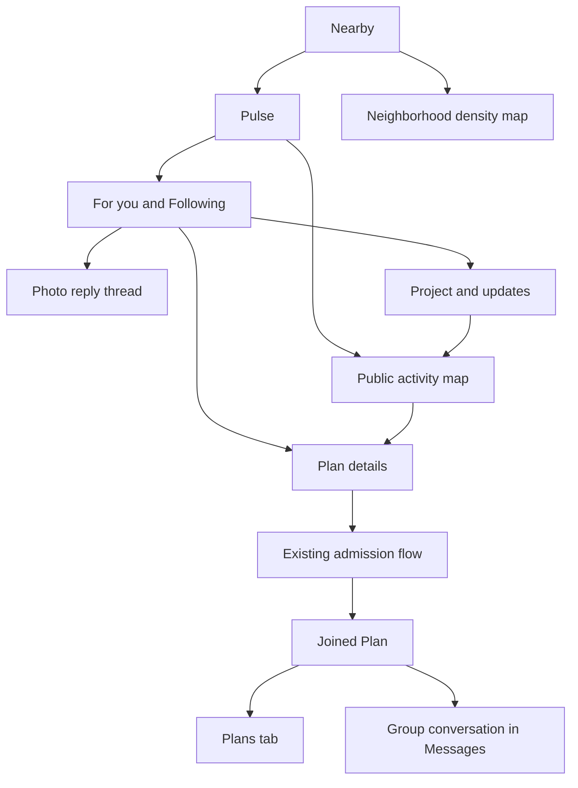

# Pulse Feed and Activity Map Design

> **Repository review copy.** This is a design proposal, not an implementation backlog or authorization to change app code, navigation, launch flags, or existing admission rules. It does not supersede the founder’s checklist or approved build instructions.
>
> Source: [Draft Pulse Feed and Activity Map Design](https://chatgpt.com/space/page_cae6dec87ca88191be7e7428745f8c12). Saved from the Page on October 31, 2026. The interactive prototype remains in the originating design conversation; it is not a runnable repository feature.

**Draft for product and design review · October 31, 2026**

Pulse should make people curious about one another and give that curiosity somewhere to go: a photo reply, an unfolding project, or an activity they can join. The proposed experience combines an expressive feed with a map of public activities, while keeping Pulse inside Pantopus and connecting participation to the existing Plans and Messages experiences.

The design centers on three actions: **Add your version**, **Follow what happens**, and **Join in**. A normal text or media post remains valid on its own. These actions are optional ways to deepen a post, not mandatory posting formats.

This is a product proposal based on the interactive “Pulse people, projects, and participation” mockup. It authorizes no implementation, navigation replacement, feature activation, or production change.

## Product direction

The founder’s concern is that Pulse feels dated and too close to a neighborhood bulletin board. Visual polish alone will not resolve that concern. The content people encounter, the ways they can respond, and what brings them back must change together.

The intended feeling is: “Interesting people are doing things here, and I can be part of it.” People’s humor, progress, questions, taste, and imperfect attempts lead the experience. Geography helps people discover and participate; it does not define the value of every post.

This approach is broader than a crafts or meetup app. The mockup uses pottery, music, and drawing to demonstrate behavior. The same patterns should work for cooking, games, photography, sport, culture, personal observations, and other interests.

### Goals

- Make the feed enjoyable before a person has a large social graph.

- Make posting feel natural, with text and media first and an optional place.

- Make responses expressive enough to become interesting content themselves.

- Give people a reason to return to an evolving story.

- Make the map useful for discovering activities and moving into participation.

- Preserve Pantopus identity, existing navigation, and established privacy and membership rules.

### Outside this proposal

The separate worldwide discovery app remains a different product. This proposal does not introduce a new account system, identity federation, a global live broadcast network, AR, creator payments, or a replacement for the household experience.

Pulse can support discovery beyond a person’s immediate area. A local starting location must not become a permanent browsing boundary. The initial mockup, however, demonstrates one area; it does not establish a working worldwide content network.

## Relationship to existing product decisions

This concept is a new direction for review, not a declaration that older launch decisions have already changed.

| Area | Design position |
| --- | --- |
| Outer navigation | Keep Place · Today · Nearby · Plans · Messages when Plans is enabled. Preserve the existing flag behavior when it is unavailable. |
| Nearby | Keep Pulse and Neighborhood as separate segments. Nearby opens on Pulse. Connections remains in the side menu. |
| Two different maps | The proposed Pulse map shows public activities. Neighborhood retains its density map and neighborhood setup experience. Do not combine their data or labels. |
| Launch flags | Leave the paused Pulse redesign and its activation policy unchanged. This proposal does not choose or enable a release flag. |
| Posting policy | Personal expression without a place is a proposed departure from the older “General ban” and place-attached Moment rule in NEXT_STEPS. The founder must explicitly adopt the new posting policy before implementation. |
| Plans admission | Existing eligibility, host approval, verification, age-related restrictions, and public-place requirements continue to govern each Plan kind. |
| Other boundaries | Preserve the refusal of crime and suspicion Heads-ups and the existing restriction on businesses initiating neighborhood-feed posts. Commercial promotion is outside the first release. |
| Platforms | Design primarily for iOS and Android. Preserve web compatibility; any web redesign requires its own scope decision. |

A person following a project does not become a connection, gain access to private posts, or receive permission to message its author. Discovering an activity does not establish eligibility to join it.

## People and core journeys

Pulse should serve people who browse without posting, people who occasionally share something, people documenting an ongoing effort, and hosts inviting participation. None should have to become a professional creator to make the product useful.

### Share something and receive a meaningful response

Maya posts, “I made a mug. My entire personality is now this mug.” Luca adds a photo of his own collection with “This escalated.” The reply is visibly connected to Maya’s original. A reader can enjoy the exchange, contribute, or follow Maya.

### Return to an unfolding story

Jae posts an idea for starting a band. Later updates show the first rehearsal and the first complete song. A reader follows that project specifically, receives its updates in Following, and can look back at the beginning without searching Jae’s entire profile.

### Discover an activity and participate

A reader filters the map to Music, opens Jae’s acoustic jam, reviews the time, venue, admission rules, and remaining places, then joins or requests to join. Once admitted, the activity appears in Plans and its conversation is available through Messages.

Each journey has value before the final action. Reading, looking, saving, and following are legitimate outcomes; Pulse should not pressure every visitor to post or meet strangers.

## Navigation and information architecture

The existing Pantopus shell stays recognizable. The menu remains at tab roots, while pushed detail screens retain Back or Close controls.

Pulse has two feed choices: **For you** and **Following**. A clearly labeled **Map** button opens its activity map. The map has a **Feed** return action. Switching views preserves the feed position, map area, filters, and selected activity.

A deep link should open the referenced post, project update, or Plan and retain a useful return path. Signing in must resume the intended destination without automatically posting, following, or joining.

## Feed design

### Content and hierarchy

Lead each post with its author, a restrained context line, and the actual post. Avoid a promotional hero banner above the feed. Place and distance appear only when they help explain the content.

Use three optional treatments within a consistent post structure:

| Treatment | Content emphasis | Main action |
| --- | --- | --- |
| Ordinary post with photo replies | The author’s text or media, followed by one relevant response preview | Add your version |
| Project update | The newest update, project title, and a short indication of its place in the story | See the story or Follow progress |
| Invitation linked to a Plan | The host’s invitation, time, public venue or labeled area, and admission state | See the plan |

Text-only posts must look intentional. Media should retain a sensible aspect ratio and open into a viewer when necessary. Do not force every post into a poster, oversized headline, or identical promotional card. A post can be funny, unfinished, thoughtful, or informative without becoming an event.

Keep standard reply, save, and reaction actions available but visually secondary to the content. Report, block, mute, and “Show fewer like this” belong in a consistent overflow menu.

### For you and Following

**For you** proposes public content using explicit interests, followed people and projects, freshness, useful interaction history, and the chosen browsing context. Location is one signal; it must not quietly exclude relevant content elsewhere. Explain recommendations with plain reasons such as “Because you follow music.”

**Following** shows eligible updates from followed people and projects, newest first in the initial release. A project follow is distinct from a person follow. If both match the same update, show it once.

Start with understandable ranking rules. Avoid optimizing for raw comment volume, outrage, or session length alone. Apply author diversity and repeated-content limits so one active account or project does not dominate. “Show fewer,” mute, and block must materially affect subsequent results.

When nearby supply is thin, show an honest end state and offer broader interests or another area. Do not disguise distant posts as local or manufacture activity.

## Composer and publishing

The composer starts with the person’s words and attachments. An audience control is visible before publishing. “Add a place” is optional and separate from the audience choice.

The first release should support text and photos through the existing media pipeline. Existing supported media should not regress, but new video editing, live streaming, audio formats, and long-form article tools are outside this slice.

Offer optional actions after the basic draft is understandable:

- **Add your version** opens a reply composer with the original visible.

- **Start a project** gives an ordinary post an ongoing title and followable sequence.

- **Add an update** selects a project the author can manage.

- **Attach a Plan** links to an existing eligible Plan or opens the established Plan creation flow.

Avoid an initial wall of content-type choices. A project can start with one post; an invitation does not require duplicating Plan details.

### Audience and place

Use the existing product audience vocabulary where possible. The mockup’s Public and Connections options are conceptual choices, not new access-control definitions.

A public post may be discoverable without a place. A restricted post must not appear in public map results, thumbnails, counts, search suggestions, or notifications. Selecting a place must never widen the audience. Precise device location must not be automatically attached.

For a restricted response to a public original, offer an explicit **Share privately** path. Explain that it creates a separate post for the chosen audience and will not enter the public reply thread or its counts. The mockup demonstrates this separation, but the production composer must make the change of action unmistakable.

### Publishing states

Preserve drafts when upload or submission fails. Show upload progress, allow cancellation, and make retry safe against duplicate publication. Publishing is complete only after server confirmation. Failed media must not leave a misleading empty public post.

Changing audiences or editing a place requires rechecking visibility of dependent previews. Existing replies must never become visible to a broader audience merely because a parent was edited.

## Photo replies

“Add your version” turns a response into a contribution while retaining the original context. The original post remains identifiable at the top of the reply thread. Text replies continue to work.

In the feed, show one compact photo-reply preview with the contributor’s identity and a route to all replies. Keep “photo replies” and “all replies” counts distinct and accurate. Opening a reply must preserve its connection to the original.

For the first release, default the thread to chronological order and let the author disable new photo contributions. This avoids needing a new ranking system before the interaction has proved useful.

The audience of a reply can never exceed the authorized audience of its parent. Server-side visibility checks must run before previews and counts are assembled. Blocked, removed, or restricted material must not survive as a cached thumbnail or count leak.

If an original is deleted or made inaccessible, remove its embedded media and public reply-thread entry points. Retain an author’s independent contribution only where the existing retention and audience rules permit it; show “Original unavailable” without reproducing inaccessible content. Authors can delete their own contributions, and users can report either the original or a reply.

## Projects and updates

A project is a sequence of posts connected by an ongoing effort: learning a song, building something, training, cooking through a book, or documenting an experiment. It is not a requirement to create a formal group.

A project detail screen shows its title, owner, current update, and earlier updates in a clear order. The mockup uses Day 1, Day 4, and Today. Production labels should use real timestamps and an ordered update index, with absolute dates available for clarity.

Only the owner can add or reorder updates in the first release. Each update has a stable identity so replies, saves, and links continue to work after editing. A project may be marked completed or paused without erasing its history.

Following a project adds eligible new updates to Following. It does not automatically enable push notifications. Offer a separate notification preference using the existing notification system, with deduplication when the person also follows the author.

A project can link to a Plan. The Plan’s state remains authoritative. A cancelled invitation must show as cancelled in old project updates, rather than continuing to invite people through stale copy.

## Pulse activity map

### What the map represents

The map answers, “What could I take part in here?” Pins represent public activities with a useful action, hosted by identifiable people. They do not represent a person’s live position, private home, household membership, or verified residency.

The first release maps eligible invitations connected to Plans. Projects appear through their attached public activities. Ordinary posts do not gain pins merely because someone attached a city; broader place-based discovery can be evaluated later.

The map should dominate the screen, with one selected activity card. Use legible streets and landmarks, a clear selected pin, and compact labels describing the activity. Interest filters can include Making, Music, and Drawing; the final taxonomy should reflect actual supply. “Join in” should become an availability filter if needed, rather than duplicating an all-activities filter.

### Browsing and selection

Start from a person’s chosen area or an authorized device location. Permission denial still allows manual city search. Allow browsing another city without pretending the person lives there.

Panning preserves the current selection until the user searches the new area or selects something else. Offer “Search this area” after a meaningful move. Support pinch zoom, clusters at high density, and an accessible list of the same eligible results. Feed and map must use the same underlying activity records.

A pin preview includes a short activity label and a meaningful state such as the scheduled day, available places, or “You’re in.” A selected card shows the host, invitation, time, location precision, and one primary action.

Examples from the mockup:

- **Sketch badly with us** at Esther Short Park.

- **One song. No auditions.** at Waterfront Park.

- **Mug-making, round two** in an approximate downtown area.

An approximate area must look approximate, not like a precise venue. If the meeting point is unconfirmed, say so. For the initial release, keep joining unavailable until the existing Plan rules permit the location and admission; “Location being confirmed” is a status, not a fabricated meeting point.

### Activity lifecycle

Show available, approval required, requested, joined, full, cancelled, and ended states distinctly. Remove ended activities from the default upcoming view. Keep linked history available where authorized.

Counts reflect actual admission and capacity, not clicks or optimistic requests. A “live” label requires a defined, fresh source of activity; decorative pulsing pins must not imply current attendance.

The mockup demonstrates selection and interest filtering. Its three fixed pins do not implement panning, geographic search, clustering, real availability, or a worldwide dataset.

## Plans and Messages integration

An invitation is an entry point into the existing Plan, not a parallel event product. The same title, schedule, venue, host, capacity, membership, cancellation state, and conversation must be used everywhere.

| Admission state | Primary action and result |
| --- | --- |
| Eligible for immediate admission under existing rules | Join plan; show joined only after the server confirms membership |
| Host approval required | Request to join; show Request sent and allow withdrawal |
| Ineligible | Explain the applicable requirement and offer an existing next step where available |
| Capacity reached | Show Full; expose a waitlist only if the existing product supports it |
| Joined | View plan and Message group |
| Cancelled or ended | Show the state; do not offer a new join |

The mockup’s immediate join is a demonstration shortcut. Production must not replace host approval, verification, age-related checks, or other Plan safeguards with an unrestricted “I’m in” button.

Before joining, explain which profile information becomes visible to admitted participants. Public browsing need not expose the full participant roster. Group conversation access begins and ends according to existing membership policy; a pending request must not reveal private messages.

Join retries must be idempotent. Two people competing for the final place cannot both be admitted beyond capacity. Leaving updates the Plan, map card, feed invitation, and conversation access consistently. Host cancellation should propagate to every entry point and use the existing notification rules.

## Visual and interaction design

The mockup proposes warm neutral surfaces, an indigo accent, and restrained lavender and coral content treatments. These are a direction for review, not authorization to replace Pantopus design tokens across the app.

Keep a clear type hierarchy, generous spacing around the post itself, and compact metadata. Use familiar iconography and plain action labels. Preserve a consistent card anatomy while letting photos, text, project updates, and invitations have different visual rhythms.

Use motion to explain an action: expanding a selected activity, adding a reply, or moving between project updates. Avoid constant animation, simulated activity, autoplay sound, and effects that make browsing harder. Honor reduced-motion settings.

Requirements include light and dark appearance, text enlargement, meaningful image descriptions, captions for supported video, visible keyboard focus, screen-reader reading order, and touch targets appropriate to each platform. Selection cannot rely on color alone. At a 320-pixel viewport, essential text and actions must fit without horizontal scrolling; map results must also be operable from a list.

The composer must retain its draft through interruptions. Returning from a detail screen should restore the prior feed position or map selection, rather than resetting exploration.

## Empty error and changing states

| Situation | Required experience |
| --- | --- |
| No followed people or projects | Explain Following and offer a direct route to explore; do not auto-follow accounts |
| No activities in an area | Say that none match; offer a wider area or different interests without silently broadening |
| Location permission declined | Continue with a manually chosen place |
| Feed or map cannot refresh | Retain cached content, label it as potentially out of date, and provide retry |
| Photo upload fails | Keep text and attachment state, show the failed item, and retry without duplicate publication |
| Final place is taken during join | Explain the current capacity; do not show false membership or open the group |
| Host approval pending | Preserve Request sent across refresh and relaunch |
| Content removed or audience changed | Clear inaccessible previews and offer a neutral unavailable state |
| Plan cancelled after someone joins | Update every linked card and use the existing cancellation notification flow |
| Block or mute applied | Remove affected discovery content and enforce access policy consistently |
| User returns through a deep link | Restore the authorized destination after sign-in without repeating a consequential action |

Offline viewing may use cached data. Offline posting, joining, and sending must show a pending or unavailable state until confirmed; cached availability must not be presented as a guaranteed place.

## Implementation approach

This is a behavioral design, not a database schema or a claim that the current code already supports every relationship.

Before implementation, inventory the existing feed, composer, media handling, replies, follows, saves, Plan routes, membership service, conversations, notification controls, map components, and open work. Extend those paths rather than building a second social stack.

The logical relationships are straightforward: a reply references its parent post; a project groups ordered updates; a project follow references that project independently of its owner; an invitation references a Plan; and a map result is an authorized projection of an eligible Plan. These describe capabilities, not new table requirements. Any new table needs the founder’s approval, and migrations must remain additive.

The server must enforce audience, blocking, ownership, admission, and membership before returning content, counts, thumbnails, or notifications. Client-side hiding is insufficient. Deletion and audience changes must invalidate dependent feed and map projections.

Use the existing media pipeline with appropriately sized previews, lazy loading, cancellation, and retry. Use viewport-bounded geographic queries and clustering rather than downloading every activity. Cache feed pages and map results with explicit freshness, and preserve stable identifiers for navigation and deduplication.

Start with explicit interests and explainable ranking. Machine learning, generative content, AR, and new real-time infrastructure are not dependencies for proving these three interactions. Select any new provider or library only after the existing capabilities and a measured gap are known.

Keep the existing launch path intact. Select a release flag strategy during implementation planning; this document neither repurposes nor activates the paused redesign flag.

## Content supply and first release

The first experience needs a credible mix of ordinary expression, continuing stories, and invitations. Do not make every card a meetup, business promotion, polished travel image, or household notice.

Recruit a small set of real contributors across several interests and help them post their actual work, observations, and updates. Use the initial geographic area to learn how participation works, while allowing broader public interest content to keep the feed useful.

If platform-curated material is used, label its publisher and exclude it from organic participation metrics. Never fabricate people, comments, attendance, or “happening now” signals. The fictional identities and illustrative photos in the mockup are design fixtures and must not become production seed accounts.

### Proposed delivery sequence

1. **Resolve the product policy and audit reuse.** Confirm personal expression without a place, supported audiences, project ownership, Plan eligibility, and the release boundary.

2. **Deliver the expressive feed and photo replies.** Preserve ordinary posting, add connected media replies, and make Following, save, mute, block, report, and empty states coherent.

3. **Deliver followable projects.** Support creating a project, adding updates, viewing history, and following independently of the author.

4. **Connect the activity map to existing Plans.** Add interest browsing, truthful activity states, admission, and the route into the existing group conversation.

5. **Run a limited pilot and refine.** Expand geography and ranking only after observing real content supply and participation.

The three main journeys form the complete first-release concept, but they can ship in reviewable slices. Do not launch attractive entry points that end in a dead button or an unrelated screen.

## Success measures and product validation

The product hypothesis is that people return because they are interested in someone or something unfolding, and can contribute when they choose. Longer scrolling alone is not evidence that the design is working.

Track these measures separately and segment by interest, geography, and new versus returning users:

| Question | Measure |
| --- | --- |
| Does the feed lead to meaningful interest? | Unique viewers who follow a person or project, save a post, or contribute an eligible reply, divided by unique viewers of the relevant content |
| Do photo replies create conversation? | Published photo replies per eligible original-post viewer, plus the share of originals receiving a contribution from another person |
| Do projects bring people back? | Project followers who return to view a later eligible update within a defined observation window |
| Does the map help participation? | Activity-detail opens, join requests, confirmed admissions, and later Plan engagement as separate funnel steps |
| Is participation actually useful? | Optional post-activity feedback, repeat participation, and host satisfaction; no location tracking as a proxy for attendance |
| Is the experience healthy? | Hide, mute, block, and report rates; concentration by author; cancellation and no-show feedback; upload and join failures |

Count successful server-confirmed actions, deduplicate retries, and exclude fixtures and labeled platform publishers from organic measures. Use coarse aggregate geography and avoid collecting precise movement data for this evaluation.

Before implementation approval, test the prototype with people who use Pantopus and people unfamiliar with it. Ask them to find something they would follow, contribute a version, locate an activity, explain who can see their post, and distinguish Pulse’s map from Neighborhood. Observe whether the actions make sense without coaching.

A specific perception question is: “What kind of app does this feel like, and what would you post here?” If people still describe only neighborhood notices, service recommendations, or a meetup directory, revisit content selection and interaction prominence. Establish numeric release targets after a baseline and a first usability round, rather than treating invented targets as evidence.

## Acceptance and release review

Verification must cover the real clients and shared backend once implementation is authorized. A working mockup or green CI is not proof of the shipped behavior. Use the relevant existing checks and real-app journeys; do not add unit tests merely to mirror the design.

1. One user publishes an ordinary post without a place; another eligible user can discover it. A restricted viewer cannot retrieve its private counterpart.

2. A second user adds a photo reply; both users see the correct parent, media, and counts after reload or relaunch.

3. Sharing privately does not add an entry or increment counts in the public original thread.

4. Following a project exposes later authorized updates without automatically following the author or enabling push notifications.

5. Editing, deleting, blocking, and changing audience remove inaccessible content from feed, search, map, cached previews, and notifications as applicable.

6. Map interest filters and area search show the same authorized activities as their list representation. Approximate locations remain labeled and do not expose private coordinates.

7. Joining an eligible Plan updates all entry points. Approval-required Plans remain pending, and two simultaneous final-place attempts respect capacity.

8. A pending or ineligible person cannot open the participant conversation. Leaving or cancellation follows the existing access policy.

9. Deep links, Back, feed position, drafts, and map state behave correctly after sign-in and relaunch.

10. The enabled and disabled feature states preserve the existing navigation, side menu, Neighborhood map, and compatible web behavior.

11. Text enlargement, screen readers, reduced motion, low bandwidth, failed media, and permission denial leave the core journeys usable.

Record iOS, Android, web compatibility, hosted services, and physical-device evidence separately. Do not claim unperformed checks.

## Decisions for the next review

The recommended direction is to retain the current Pantopus shell and approve a more expressive Pulse with optional place context, connected photo replies, followable projects, and public activities linked to Plans.

The next review should settle five concrete decisions:

- **Posting policy:** adopt ordinary personal expression without requiring a place, and define its relationship to existing allowed categories.

- **Audience rules:** confirm the existing audience names and the explicit separate flow for sharing a response privately.

- **Project scope:** begin with a single owner and independent project follows; defer collaborative editing.

- **Map eligibility:** begin with existing supported public Plan kinds, confirmed eligible meeting locations, and existing admission rules.

- **Delivery scope:** choose the first contributor cohort, platforms, and release-flag boundary after the existing implementation and overlapping work are inspected.

These choices should be recorded before implementation begins. The mockup is a design reference, not approval to relax privacy, verification, or Plan admission.

## Mockup reference and source boundaries

The reference is **Pulse people, projects, and participation**, with Feed and Map starting views and local simulated flows for the composer, photo replies, project history, Plan details, and group conversation. Its source artifact in this chat is `pulse-people-concept.html`.

The prototype checks covered a public photo reply, project following and its Following feed, map interest filtering, a simulated join and local group message, and narrow-screen layout. The prototype does not test backend persistence, real users, production media, ranking, moderation, geographic search, or Plan authorization.

This specification deliberately adds behavior the mockup only sketches: project creation, real upload recovery, map browsing and clustering, privacy enforcement, full admission states, lifecycle changes, and cross-client persistence. It also replaces the mockup’s immediate-join shortcut with existing Plan admission rules.

Product constraints were checked against the repository’s [founder checklist](../../NEXT_STEPS.md), [mobile pilot build brief](../mobile-pilot-build-brief-2026-10-03.md), and [paused Pulse build notes](pulse-build/README.md). Later founder amendments govern over older conflicting entries. These references establish design constraints, not a claim about current production configuration or deployed behavior.
