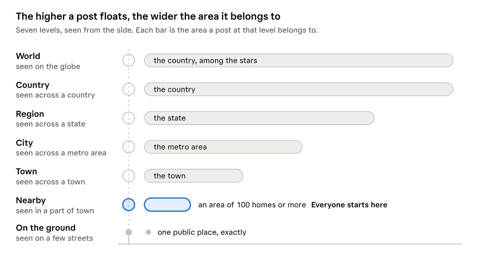
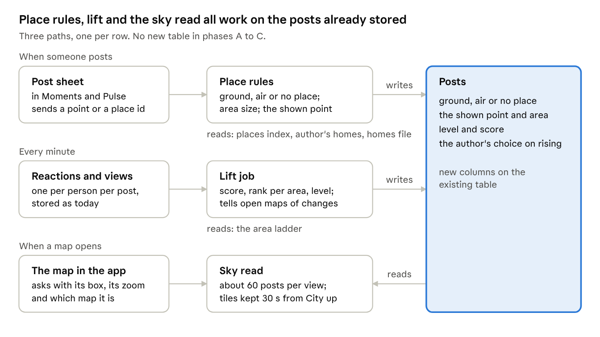

# The Sky: floating posts, levels and approximate places

Design, November 14, 2026. This is a copy for builders of a private Claude Doc; the founder accepted its sixteen decisions that day. The founder also accepted the nine calls of the [phase A contract](02-phase-a-contract.md) that day, and the sentences they change are changed here.

## Summary

The Sky puts every Moment and Pulse post on the map at a height that shows how far it reaches, and at a place that is only as exact as is safe. It makes three changes.

1. **Approximate by default.** A post belongs to an area, not a spot. An exact pin is possible only at a public place the author picks by name. A post made at home is always an area.
2. **Posts float.** What sits on the ground is exactly there. What floats belongs to the area under it. The picture tells the truth about how exact a place is.
3. **Height means reach.** Everyone starts at the base level. Reactions from real people lift a post: town, city, region, country, world. The higher it floats, the farther away it is seen, and the wider the area it belongs to. A world-famous post floats in space over a country, never over a street.

Pantopus was never meant to be only local. The Sky keeps the local layer whole at the bottom and adds every wider layer above it, on one map.

**What stays.** The tabs, List | Map, Connections, and how long a Moment lasts (1 to 48 hours). No live location and no trail between posts. Everything new sits behind a switch, and app builds already in the stores keep working.

## Principles

Every later choice in this document follows from these seven rules.

1. **The picture tells the truth.** A pin on the ground means exactly here. A floating post means somewhere in the area below.
2. **The more people can see a post, the less exactly it can be placed.** Reach and precision move in opposite directions.
3. **Up close, local wins.** A famous post overhead never covers the yard sale next door.
4. **An ordinary person's post rises far only with their yes.**
5. **No live location and no trail.** Only the posted point is kept, and nothing joins one post to the next. This is true today and stays true.
6. **One meaning for lift.** Lift shows reach. Real elevation keeps its own colour, number and view.
7. **Safety rules live on the server.** They protect people on app builds already in the stores, not only on new ones.

## Where a post is

Every post is in one of three states, and the author sees which one before posting. Approximate location is half built today; this section finishes it.

| State | When | What other people see | Drawn as |
| --- | --- | --- | --- |
| In the air (the default) | Any post, unless the author pins it at a place. Always at home. | An area that holds at least 100 homes, and the town's name | A bubble floating over a soft disc as wide as the area |
| On the ground | The author picks a public place by name from the list: a park, a café, a stadium | That place, exactly, and its name | A pin standing on the map |
| No place | The author chooses "Don't show where" | No place at all; connections only | Not on the map; in the row of faces |

### What changes from today

|  | Today | With the Sky |
| --- | --- | --- |
| A Moment's default | An exact pin where the phone is | An area |
| Where an exact pin is allowed | Anywhere, a residential street included | Only at a public place picked by name |
| A Moment within about 60 m of the author's home | The app warns; the author still chooses | Always an area, no choice |
| A Pulse post with a photo | An exact pin where the photo was taken, the author's home included (decided November 5) | Exact only at a public place the author picks; otherwise an area. Posts already made follow the new rule when read |
| Size of an area | One fixed grid cell, about 555 m by 390 m here | Grows until it holds at least 100 homes, up to the whole town |
| Timing | Posted now | "Share now" or "Share later" (in 1 hour, in 3 hours, tonight). A later post says "Earlier today" |

### How an area is chosen

- **The grid stays.** The area's point is the centre of its grid cell, so every post from one spot shows the same point and many posts never narrow it down. Today's secret offset is dropped (decided November 14): it made the real uncertainty about half a mile in every direction, and the 100-home rule now carries the protection.
- **The cell grows where homes are few.** The server tries cells of about 0.5 km, 1 km, 2 km and 5 km, and uses the smallest one that holds at least 100 homes. If none does, the area is the town.
- **Size depends on the place only.** It never depends on the person or the post, so it gives nothing away about either.
- **The disc is honest.** It is the circle around the cell, about 0.4 mile across at its smallest, so the picture shows the real area and nothing wider.
- **Home counts come from a file.** In the US it is built from the 2020 Census housing counts by block, which cover every state (decided November 14). Elsewhere it comes from a public population grid. Where there is no count, the area is the town.

### What a public place is

A place the author picks from the list the server makes, as today: named places within about 1,500 m of the photo or the phone. The list leaves out homes, apartment buildings and schools. Nobody types a place's name; the app sends back only the place's id, and the server finds it again.

### The Post sheet

The sheet keeps its layout of switch rows. Its words change.

- The top line says where the post will appear: "Floating over Vancouver, WA" or "At Esther Short Park".
- "Show the area instead" becomes "Pin it at a place", which opens the place picker. It is off by default.
- "Don't show where" stays.
- "Show elevation" stays. For a floating post it shows the elevation rounded to 100 ft, since an exact number on a hillside can narrow an area down. At home it shows nothing, as today.
- A new row, "Share later", holds the post on the server until the chosen time.

## Levels: height means reach

A post's height is how far away it can be seen. Everyone starts at the same base level, and reactions from real people lift a post from there.

Read it from the bottom: a pin on the ground is one exact place, and each level above belongs to a wider area and is seen from farther away.

| Level | Name | Seen when the map shows | The post belongs to | Its label reads |
| --- | --- | --- | --- | --- |
| 0 | On the ground | A few streets | A public place | "At Esther Short Park" |
| 1 | Nearby (everyone starts here) | A part of town | Its area of 100 homes or more | "Vancouver, WA" |
| 2 | Town | A town | The town | "Vancouver, WA" |
| 3 | City | A metro area | The metro area | "Portland area" |
| 4 | Region | A state | The state | "Washington" |
| 5 | Country | A country | The country | "United States" |
| 6 | World | The globe | The country | "United States" |

A post pinned at a public place keeps that place's name at every level ("At Moda Center, Portland"), because the place is public. A floating post's place widens with each level.

### How a post rises

- **The score counts people, not taps.** Each different person who reacts counts once. A reaction from an account less than 7 days old counts as one fifth.
- **Views count, lightly.** Each different viewer counts as one twentieth of a reaction, and views can make up at most half of a score. Views are easy to fake, so they help a post rise but cannot carry it alone.
- **Rising is by rank, with a floor.** A post rises to a level when it is among the top posts in that level's area right now and has cleared a small minimum.

| To reach | Top posts kept per area | Minimum different people reacting |
| --- | --- | --- |
| Town | 10 per town | 5 |
| City | 10 per metro area | 25 |
| Region | 10 per state | 100 |
| Country | 20 per country | 500 |
| World | 30 | 2,500 |

These numbers are starting points to tune.

**Why rank and not fixed numbers.** With fixed numbers the sky is empty while Pantopus is small and choked when it is big. With ranks every town always has a few posts overhead, the map never carries more than it can draw, and the system needs no retuning as the app grows.

### How a post sinks

- A Moment's score halves every 6 hours. It ends within 48 hours and then drifts off the map.
- A Pulse post's score halves every 24 hours.
- A post overtaken by others drops a level. Nothing stays in the sky for old reactions.

### The author's yes

- Rising to Town is automatic.
- Rising past Town needs the author's yes, once per post. A notice says "Your Moment is rising over Vancouver. Let it go further?" with "Let it rise" and "Keep it in town".
- A setting covers every post: ask me each time (the default), always let my posts rise, or never above Town.
- Public pages, verified businesses and Pantopus's own accounts rise without being asked.

### What never rises

- A post sent to connections only, or with no place.
- A post held for review.
- Before a post reaches Country or World, a person at Pantopus looks at it. The ranks keep that to a few dozen posts a day.

### Public pages start higher

A well-known person's post is at risk in its first minutes, before it has risen, while it still shows a part of town. So a public page's posts start at City level and default to "Share later". They are never shown at the precision of a part of town. A world-famous footballer's post from home floats in space over Portugal and reads "Portugal".

## What it looks like

The map stays a normal flat map that anyone can read at a glance, and the sky is drawn on top of it. The ten screens are drawn: see [screens](screens/) and the [README](README.md).

### On the map

- **A ground post** is today's pin, standing on its spot.
- **A floating post** is today's ring without its tail, lifted above the map. Below it lies a soft disc as wide as its area. No line joins the two, because a line would point at a spot.
- **Lift grows with level.** A Nearby post hovers just above the map. Each level floats higher, looks a little larger, and its disc gets wider and fainter. From City level up there is no disc, only the post over its area and its label.
- **The map shows the level that fits the view.** Zoomed in on a few streets it shows ground and Nearby posts. Zoomed out to a town it shows Town posts, and so on to the globe. One level above and below show smaller.
- **Overhead.** A slim row at the top of the map lists what floats above the current view: "Over Portland · 4", "Over Washington · 3", "World · 8". A tap moves the map out to that level.
- **Crowds** group as they do today. A group shows its count and its highest level.

### The sky behind it

- Close in, the map is plain.
- At City view, thin cloud appears behind the Overhead row.
- At Country view the edge of the map turns deep blue.
- At World view the map is a globe among stars. That is where the most-seen posts on Earth float.
- After sunset where the viewer is looking, the map darkens and floating posts glow. The server already works out the sun's position for the map.

### Motion

- Floating posts bob gently, a few points over a few seconds.
- A post that changes level while you watch rises or sinks to its new height.
- A Moment that ends drifts up and fades.
- With Reduce Motion on, nothing moves.

### Opening a post

- The header says where it floats and at what level: "Floating over Vancouver · Town".
- A small ladder on the edge shows the levels and where this post stands, in the style of the elevation scale already built for the viewer.
- On their own post, the author also sees whether it is rising and the control "Keep it in town".

### The list

- Each row carries a small level mark, such as "City".
- A "How far" choice replaces the distance choices: Nearby, Town, City, Region, Country, World. It is the list's version of zooming out.

### Elevation mode

Floating by real elevation is already built on both phones, behind its own switch. It stays, as a mode. With the Elevation chip on, lift shows real elevation with its band colours, numbers and sun shadows, exactly as built. With the chip off, lift shows reach. The screen always names which one it is showing.

### Everyone can use it

- Every post has a touch target of at least 44 points, and lift never pushes a post off the screen.
- Level is never shown by colour or height alone; the word is always there.
- A screen reader says "Moment from Priya, floating over Vancouver, Town level, 2 hours ago".
- Dark mode is the night sky.

### Later, on phones that can

A tilt gesture to look up through the layers, lanterns on strings after dark, and a side view that scrolls from the street to the stars. Tilt was measured on iPhone: the map itself stays smooth, but 300 posts on stalks that follow the camera drop half the frames. So tilt waits until it can be done well.

## Safety

Each threat below has a rule that answers it, and every rule runs on the server.

| Threat | The rule that answers it |
| --- | --- |
| Someone finds where a person is right now | Area by default. Exact pins only at public places. "Share later". Public pages start at City level and default to later |
| Someone works out where a person lives | Home is always an area. An area holds 100 homes or more. Every post from one spot shows the same area. No trail between posts. The label is the town |
| A burglar learns that a home is empty | A post is never tied to a home on the map. Public pages default to "Share later", which is the advice the FBI gave athletes in 2024 |
| A post takes off and exposes the part of town it came from | Its place widens as it rises. Past Town it needs the author's yes |
| Someone narrows a spot down by asking the server many questions | Kept from today: every filter, distance and count uses the shown point and whole cells. New: the area's size depends only on the place, and a floating post stores only its area point, so the exact spot is never kept |
| Someone copies the whole map | Nearby level needs a signed-in account and is rate-limited per account and device. City level and above are public by design |
| Two people silence a post by reporting it | At Nearby level two reports still hide a post until review, as today. From Town up, reports send it to review without hiding it, unless the picture check flags it |
| A flood of replies to a risen post | From City level up, replies to a Moment come only from the author's connections unless the author opens them. Reactions stay open to all |
| People cheat to rise | The score counts different real people, new accounts count little, a sudden burst from one network is held, and a person reviews before Country or World |
| Someone pretends to be a famous person | Country and World need an account Pantopus has checked, or a review |
| Crime and accusation posts | Pulse already refuses them, and that stays. A Moment passes the picture check, as today, and a review before it rises past Town |
| A photo gives the place away (a house number, a street sign) | Software cannot fully fix this. At home the Post sheet says "Photos can show where you are". Reading house numbers in the picture check is a later addition |
| Viewers' own privacy | The author sees who viewed a post at Nearby level, as today. From Town up the author sees counts only |
| Young people | Posting a Moment already requires being 18 or older, by confirmation and by date of birth on file. That stays |

### Kept from today

These protections are built and do not change.

- Photo and video files carry no location: it is removed on upload.
- Files sit in private storage behind 15-minute links and are deleted 7 days after a Moment ends.
- A post's place cannot be changed after posting.
- Elevation is never shown for a post at home.
- A push to connections says no more than the map does.

### What this does not solve

- A person who is recognised in a photo can be found by people who know the place. No map rule prevents that.
- Review before Country and World needs a person every day. At first that is the founder.
- Rules for famous people depend on knowing who is famous. That needs the "really them" check, which is not built.

Source for the FBI's advice to athletes: [ESPN, December 2024](https://africa.espn.com/espn/story/_/id/43227536/fbi-warns-leagues-targeted-burglaries-athletes-homes).

## Moments and Pulse

Both use the same sky, the same levels and the same place rules, and each keeps its own tab.

|  | Moments | Pulse |
| --- | --- | --- |
| What it is | A photo, a short video or a text card that lasts 1 to 48 hours | A post people reply to |
| Where it shows | The Moments map | Pulse's List and Map |
| Starts at | Nearby | Nearby |
| Sinks | Score halves every 6 hours | Score halves every 24 hours |
| Who can post | People 18 or older, and businesses | People; businesses reply and do not start posts in Nearby (the rule stays) |
| Apps today | iPhone and Android | Web, iPhone and Android |
| What changes for reach | A Moment could be seen only by people looking at that spot. Now it can rise | Nearby read at most 100 miles, and only Pantopus's own accounts could post country-wide. Now any post can rise, and "How far" replaces the distance choices |

- **Connections** work as today in both. A post sent to connections never rises.
- **Country-wide posts** from Pantopus's own accounts, such as the sports lane, become Country-level posts. The mechanism they use today is the same idea under another name.
- **The tabs do not change.** Whether Moments and Pulse should one day share one map is a separate question, and this design does not need the answer.

## Architecture

The design adds four parts to the server and one drawing module to each app, and it needs no new database table for its first three phases.

Posting decides a post's place once. The lift job moves its level every minute. The map only reads.

### The parts

1. **Place rules, at posting time.** The code that names a Moment's place today also decides its state (ground, air or none), the size of its area and the point shown. It reads three things: the places index, the author's homes, and the homes-per-cell file.
2. **The homes-per-cell file.** Built offline from the 2020 Census housing counts, kept in the private bucket and read into memory, the way the property index is read today. It says, for each grid cell, which size step holds 100 homes.
3. **The area ladder.** Town, metro area, state, country. A table of areas exists and holds three launch towns with outlines from the Census; the other US towns are loaded from the same source. Metro areas, states and countries are added to it as new kinds of area. Outside the US the outlines come from public boundary sets.
4. **Lift.** A job runs every minute. For posts with new reactions or views it works out the score, then for each area takes the top posts and sets their level. It writes only the posts whose level changed, and tells open maps in that area.
5. **The sky read.** One request per map view: the box, the zoom and which map (Moments or Pulse). The answer holds at most about 60 floating posts and groups, each with its shown point, its level and its disc, plus the Overhead counts.
6. **Drawing.** Each phone already has a module that draws floating posts from a number. It takes the level as a second input. The web's Pulse map gets the same drawing with lifted markers and circles.

### Stored data

- **On each post, new columns:** its level, its score, the area it belongs to at that level, the author's choice about rising, and when it was last worked out. These are additions to the existing post table.
- **Areas:** new kinds in the existing areas table. No new table.
- **Reactions and views** are already stored per post and per person. Nothing changes there.

### Why it stays fast

- **Ranks cap the load.** A view never holds more than the top few posts of each level, however many exist.
- **The higher the level, the more it can be shared.** City level and above look the same to everyone apart from blocks and mutes. The server builds each map tile's answer once, keeps it about 30 seconds, and filters it per viewer. Nearby stays per viewer, as today, over a small area.
- **Targets:** a map answer in under 300 ms for 95 of 100 requests, and a post's level no more than a minute behind its reactions.

### App builds already in the stores

- Every place rule runs on the server, so old builds are protected the day the server changes.
- Old builds keep calling today's map routes. Those routes answer with each post at its widened point, as an ordinary pin or ring, never more exact than a new build would show.
- New fields are added, never changed or removed. Each phase is checked against the store builds before it merges, as the elevation work was.

### Switches

Three, each off until the founder turns it on, each reversible in about a minute: place rules, the floating look, and levels. Turning the place rules off returns to today's behaviour.

### As Pantopus grows

| Users | What carries it |
| --- | --- |
| Up to about 1 million | The database alone: columns on posts, the one-minute job, tile answers kept in memory |
| Up to about 50 million | Counters and ranks move to a fast in-memory store. Tile answers move to the content network. Video is served from the content network |
| Beyond | The sky becomes its own service, run per world region. Scores come from a stream of events. Area and home-count data cover every country |

## Build order

Five phases, safety first, each one useful without the next and each needing the founder's OK before it starts.

| Phase | What people see | Where the work is | Size |
| --- | --- | --- | --- |
| A. Approximate, fully | Posts are areas by default. Exact pins only at public places. Home is always an area. Areas grow where homes are few. "Share later" | Server, the homes-per-cell file, and the Post sheet's words on iPhone and Android; the Pulse composer on all three apps | Medium |
| B. The floating look | Floating posts with their discs, ground pins for places, on a flat map | iPhone and Android reuse the floating module already built; the web's Pulse map is new work | Medium |
| C. Levels | Posts rise and sink. The map shows the level that fits the view. Overhead, "How far", the author's yes, review before Country and World | Server (score, ranks, the sky read, the area ladder) and all three apps | Large |
| D. The living sky | Cloud, deep blue and stars by zoom; night; rising and drifting; then tilt and lanterns on phones that can | iPhone and Android | Medium to large |
| E. The world | Areas and home counts for other countries, languages, the fast store and content network, a public sky page on the web | Server and web | Large |

- **Phase A changes no layout.** It is rules and words, so it can go out soonest, and it is the part that matters most for safety.
- **Each phase is checked in the real apps:** the web in a browser, the iPhone app in a simulator, the Android app in an emulator, against a real local backend, with the store builds checked against the new server.
- **Phases B and C can be drawn first.** The screens for them should be drawn and approved before any app work starts.

## How it earns

The sky earns nothing by itself and is the costliest part of the app to run, so its money lines are designed in from the start. None is built.

- **Sponsored lift.** A business pays for a marked post to float at Town or City level for a day. Each area has a fixed, small number of sponsored places. They are labelled, and they never change the ranking of ordinary posts. The price follows the level and how many people live in the area.
- **Places.** A café, a venue or a park with posts on it is a door into its business page and its Plans, where the service fees and paid spots already designed apply.
- **Public pages.** People who gain a following in the sky are the ones memberships were built for. Pantopus keeps 10% of those.
- **Events.** An organiser pays to lift a Plan in its town on the day.

The investor deck says ads stay out of neighbors' conversations and no data is sold. Sponsored lift keeps the second promise and bends the first: it puts paid posts on the map. Whether that is allowed at Nearby level, or only from Town up, is a decision below.

## What we measure

Five groups of numbers say whether the sky is safe, used and worth its cost.

| Group | Numbers |
| --- | --- |
| Safety | Share of posts shown as areas. Exact pins on residential streets (must be zero). Reports per 1,000 posts. Hours from report to review |
| Use | Posts per person per week. Map opens per day. Share of viewers who look above Nearby. Rises accepted against "Keep it in town" |
| Front door | Of people who use the Moments or Pulse map, the share who add a home within 14 days. This number says whether the sky feeds the parts that earn |
| Fairness | Share of risen posts that come from people with few connections |
| Health | Map answer time. Posts per view. How far levels lag behind reactions. Media cost per 1,000 views |

## Added on November 14, after the screens

The founder approved the ten screens and added three directions. They belong to phases C and D and do not change phase A. The details below are proposals until the founder confirms them.

### Most posts stay near the ground

The map is useful and fun because most people are at ground level together. The design already works this way: a town keeps about ten posts overhead and everything else stays at Nearby. So the close-in view is the product, and it gets the most care in drawing and in speed. The sky above is the exception that makes the ground interesting.

### A higher starting level, as a choice

- Someone with many followers may start higher if they want to. Otherwise they start at Nearby with everyone else.
- Proposed steps, to tune: 1,000 followers may start at Town, 10,000 at City, 100,000 at Region, 1,000,000 at Country.
- It is a setting, "Where my posts start", with "With everyone" and "Higher". The Post sheet can change it for one post.
- Starting higher also widens the place the post belongs to, so it is the safer choice for a well-known person.
- This replaces decision 9. Checked public pages default to "Higher" and may choose "With everyone". The home and place rules protect them either way.
- Open: which followers count. Following a person delivers nothing today, so this needs the follow work of phase C first.

### The terrain: where it is busy

- A map view where the ground rises where more is posted. A busy spot is a hill or a peak, a quiet one is low, and nothing posted is flat ground.
- In built-up places the unit is a public place: a restaurant, a venue or a park with many posts stands taller. Elsewhere the unit is the area.
- Height counts different people who posted there lately, not likes. It means "busy", never "best". The label says so in numbers, such as "42 people posted here this week". The founder's caution: higher does not mean good.
- A hill is drawn only for a public place, or for an area where enough different people posted. A home or a quiet street never becomes a hill, and a floating post counts toward its area, not a spot.
- A business cannot pay to be taller. A peak opens the place's page.
- Three views, one meaning each: the sky shows reach, the terrain shows how busy the ground is, and Elevation shows real altitude. Whether the terrain is a chip on the same map or its own screen is open, and it needs drawings.

## Decisions (made November 14)

The founder accepted all sixteen recommendations on November 14, 2026 ("Yes, all sixteen"). Nothing is built yet, and each build phase still needs its own OK.

| # | Decision | Decided |
| --- | --- | --- |
| 1 | A Moment is an area by default, not an exact pin | Yes. It is the single biggest safety gain |
| 2 | Exact pins only at public places picked by name. This reverses the November 5 choice of an exact pin wherever a photo was taken, the author's home included, and applies to Pulse posts already made | Yes |
| 3 | A post made at home is always an area, with no choice | Yes |
| 4 | The smallest area holds 100 homes | Yes, and tune it after measuring |
| 5 | Lift means reach. Real elevation keeps its chip, colours, numbers and its floating view as a mode | Yes. Nothing built for elevation is thrown away |
| 6 | Rising by rank with a floor, at the numbers in the table | Yes, as starting points |
| 7 | Views count toward height as one twentieth of a reaction, at most half the score | Yes |
| 8 | Rising past Town needs the author's yes; public pages rise without asking | Yes |
| 9 | Public pages start at City level and default to "Share later" | Yes. It needs the "really them" check first |
| 10 | A person reviews every post before Country or World | Yes. You at first, a few dozen a day at most |
| 11 | From Town up, reports send a post to review without hiding it | Yes |
| 12 | The database gains columns on posts and new kinds of area; no new table in phases A to C | Yes |
| 13 | A floating post shows its elevation rounded to 100 ft | Yes |
| 14 | Sponsored lift, and at which levels | Later, and from Town up only |
| 15 | A public sky page on the web for people with no account, showing City level and above | Yes, in phase E |
| 16 | The names: "the Sky", "Overhead", "How far", and the level names Nearby, Town, City, Region, Country, World | The names as written here |

### Next step

Done on November 14: the ten screens and the [build contract for phase A](02-phase-a-contract.md). The founder accepted the contract's nine calls the same day. Next: the go for phase A.

## What exists today

Much of the ground this design stands on is already built. This was read from the code on the staging branch on November 14; which switches are on in production was not checked.

| Piece | State |
| --- | --- |
| "Show the area instead" on the Moment Post sheet, and the server's fixed grid with a secret offset | Built |
| A notice when a Moment is within about 60 m of the author's home | Built; it warns only |
| The place picker with named public places up to about 1,500 m away, from a monthly US places index | Built |
| A Moment with no place, for connections only | Built |
| Location removed from photo and video files; private storage; deletion after 7 days | Built |
| Elevation: "Show elevation" when posting, coloured tags on the map, a scale in the viewer | Built on both phones, switch off |
| Floating by real elevation in daylight, with the sun's position from the server | Built on both phones, switch off |
| The iPhone map freezing with 300 posts in view | Repaired |
| Tilt, lanterns and the side view from the street to the stars | Not built. Tilt was measured on iPhone only |
| Map limits: 300 rings shown, 2,000 Moments read, nothing shown when the view is wider than 5 degrees | Built; ranks replace them |
| Pulse posts shown as areas to other people, except a photo post pinned exactly where it was taken | Built |
| Pulse's Nearby reading at most 100 miles; country-wide posts for Pantopus's own accounts only | Built |
| A table of areas with outlines | Built; it holds three launch towns |
| Reactions and views stored per post and per person | Built |
| Two reports hide a Moment until review | Built |
| The one-time 18-or-older confirmation for Moments and Pulse | Built |
| Moments on the web | Not built |
| A scheduled-job runner and live updates to open apps | Built. There is no fast in-memory store yet |
| A checked "really them" mark for public people | Not built |
